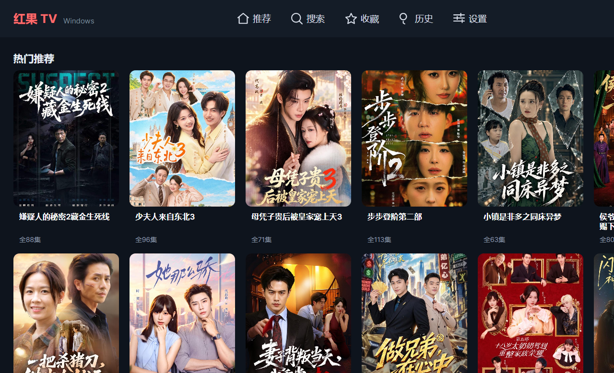
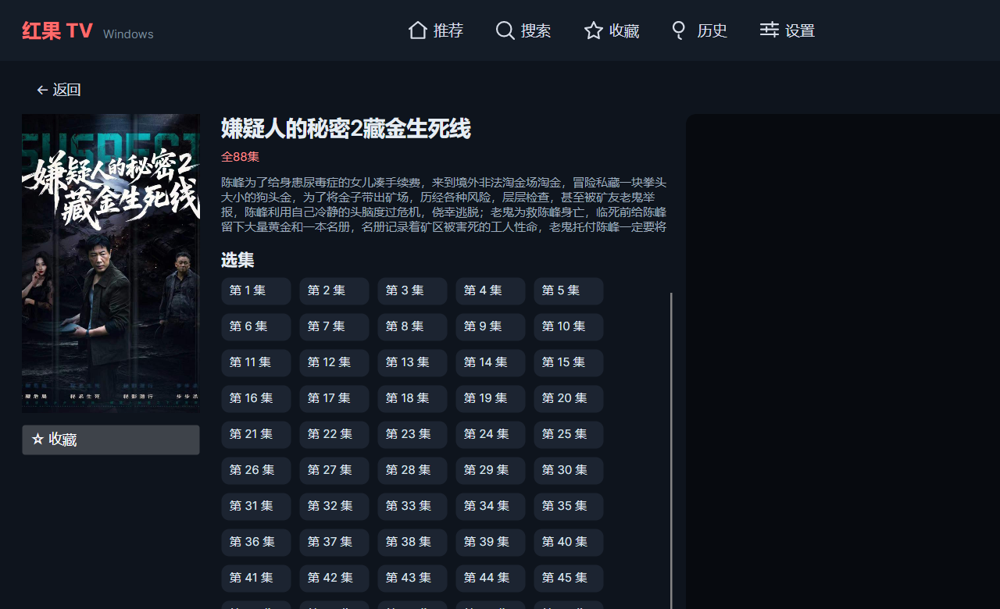
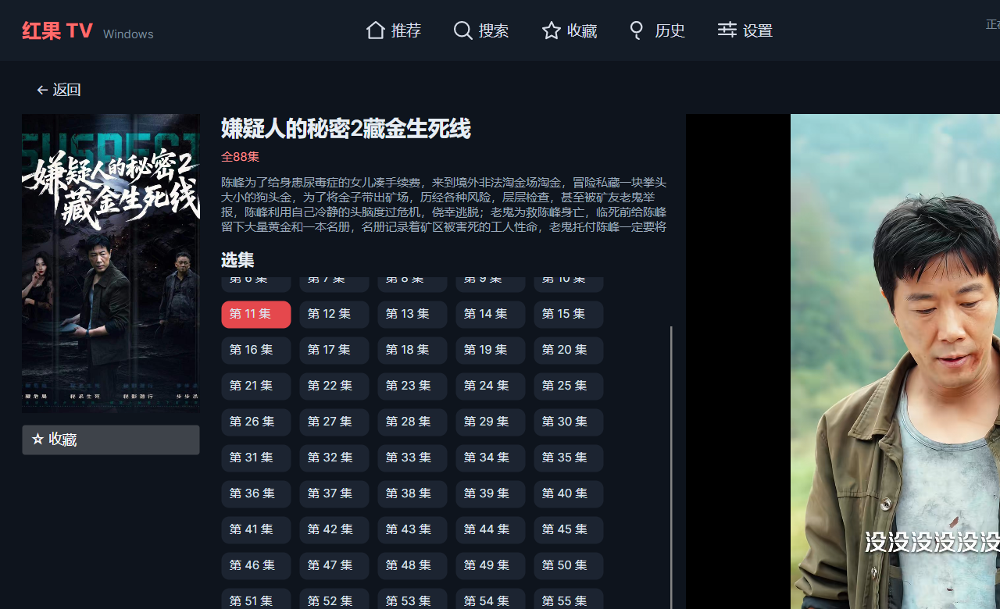

# 红果 TV · Windows（Avalonia）

从https://github.com/N3urda/hongguoTV安卓应用改造而来，感谢原作者！！！

C# + Avalonia 12 的 Windows 客户端，复用当前 Kotlin APK 的同一套内容接口与播放链路。仅新增 `desktop/` 目录，未改动仓库其他部分。

## 界面截图

| 首页 | 详情页 | 播放页 |
| --- | --- | --- |
|  |  |  |

## 结构

- `src/HongguoTV.Core`：从 `kotlin-tv/core` 移植的纯 C# 层
  - `Crypto/`：请求签名（`Signer`、`PlayerSignature`、`AesV3`、V5 常量）、匿名设备注册（`DeviceRegister`）
  - `ContentRepository.cs`：首页、搜索（App 接口 + 官网兜底 + 联想词）、详情、播放模型（v5 / video_tab / 单集三路回退）
  - `MediaCrypto.cs` / `RemoteVideo.cs`：播放 URL 解密、MP4 样本解密、HTTP Range 直连
  - `LocalMediaServer.cs`：仅本机回环的 Range 代理，把解密字节提供给 LibVLC
  - `LibraryStore.cs`：本地收藏、续播历史与设置项（`%LOCALAPPDATA%/HongguoTV.Desktop/library.json`）
- `src/HongguoTV.Desktop`：Avalonia 界面（推荐、搜索、详情选集、清晰度/倍速、播放器、收藏、历史）

## 构建与运行

```powershell
dotnet build desktop/HongguoTV.slnx
dotnet run --project desktop/src/HongguoTV.Desktop/HongguoTV.Desktop.csproj
```

需要 .NET 10 SDK。首次运行会自动从 NuGet 还原 Avalonia 12、LibVLCSharp 与 VideoLAN.LibVLC.Windows。

### Native AOT 发布

项目已启用 `<PublishAot>true</PublishAot>`，可直接发布为原生 exe（无需目标机安装 .NET 运行时）：

```powershell
dotnet publish desktop/src/HongguoTV.Desktop/HongguoTV.Desktop.csproj -c Release -r win-x64
```

产物在 `bin/Release/net10.0/win-x64/publish/`：主程序约 24 MB 原生单文件，外加 `libvlc/win-x64`（约 106 MB，含 LibVLC 3.0.24 全量解码器插件）。项目只复制 x64 一套原生库（`csproj` 里的 `VlcWindowsX64Enabled` / `VlcWindowsX86Enabled` / `VlcWindowsArm64Enabled`），发布目录总计约 148 MB（不含 PDB）。需要其他架构时用 `-r win-x86` 或 `-r win-arm64` 发布，对应架构会自动启用。

AOT 注意事项：
- 发布机需要 C++ 工具链（MSVC linker），即已安装 Visual Studio Build Tools 的“使用 C++ 的桌面开发”组件
- 本地收藏/历史已改用 `JsonSerializerContext` 源生成器，避免 AOT 下的反射序列化被裁剪（`LibraryStore.cs`）
- Avalonia XAML 依赖编译绑定（`x:DataType`），新增视图时不要漏写，否则 AOT 下会因反射绑定失效
- 已有警告即视为失败：`dotnet publish` 输出应保持 0 警告 0 错误

## 设置

导航栏的「设置」可切换视频解码方式：

- **GPU 硬件解码（D3D11VA，默认）**：占用 CPU 少，但在老显卡上解 1080P HEVC 可能出现花屏或卡顿
- **CPU 软件解码**：兼容性最好，高分辨率对 CPU 要求较高

选择保存在 `library.json` 的 `settings.useGpuDecode`，在下一次开始播放时生效。实现上必须用 `Media.AddOption(":avcodec-hw=none")`：`--avcodec-hw` 作为 `LibVLC` 构造参数传给 `libvlc_new` 后不会被 avcodec 模块继承，实测无效。

## 与 Kotlin 版的对应关系

| Kotlin | C# |
| --- | --- |
| `Signer.kt` | `Crypto/Signer.cs` |
| `PlayerSignature.kt` / `Argus.kt` | `Crypto/PlayerSignature.cs` |
| `AesV3.kt` / `V5Constants.kt` / `VendorConstants.kt` | `Crypto/` 同名文件 |
| `DeviceRegister.kt` / `PlaybackDeviceSession.kt` | `Crypto/DeviceRegister.cs` / `ContentRepository.GetProfileAsync` |
| `ContentRepository.kt` / `PlaybackModels.kt` / `MediaCrypto.kt` | 同名文件 |
| `RemoteVideo.kt` + Media3 `VideoDataSource` | `RemoteVideo.cs` + `LocalMediaServer.cs` + LibVLC |

签名层已用 Kotlin 仓库的四组 oracle 逐项校验一致：`signing.json`（12 行）、`signing-v5-carrier.json`（4 行）、`signing-v5-f13.json`（32 行）、`player-signing.json`（2 行）。

## 应用图标

- 图标文件：`desktop/src/HongguoTV.Desktop/Assets/app.ico`
- `csproj` 的 `<ApplicationIcon>` 控制 **exe 文件图标**（资源管理器显示）
- `MainWindow.axaml` 的 `Icon="/Assets/app.ico"` 控制 **窗口与任务栏图标**（项目已用 `AvaloniaResource` 嵌入）
- 替换图标时同时保留这两种用途，并确保 `.ico` 含多尺寸（16/32/48/256）以获得清晰显示

## 已知边界

- VLC 无法直接接 Kotlin 版的自定义加密 DataSource，因此 Windows 端用本机回环代理暴露解密后的字节；不监听外网地址，视频流量不落盘。
- 登录、云端历史/收藏、扫码、评论弹幕、应用内更新、跨季连播等功能尚未移植，当前覆盖浏览、搜索、详情、播放与本地收藏/历史。
- 平台接口可能随时变化；遇到播放失败请查看窗口底部状态栏提示。
